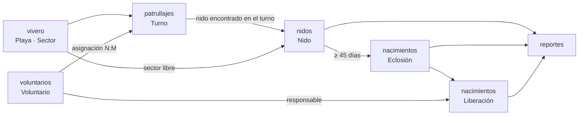
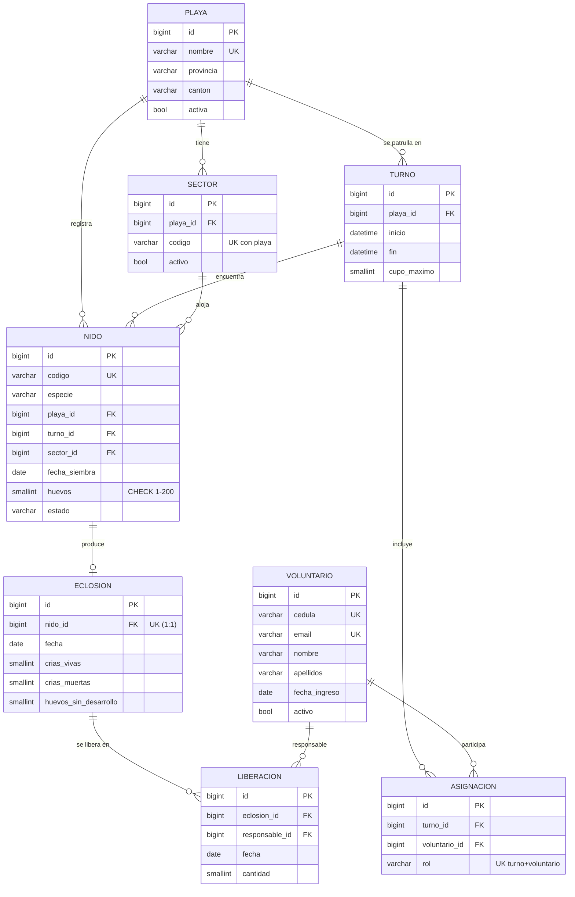

# Documento técnico — Vivero de Tortugas API

## 1. Problema y usuarios

Los proyectos de conservación de tortugas marinas del Pacífico patrullan las playas de noche durante la temporada de anidación. Cuando los voluntarios encuentran un nido, reubican los huevos en un **vivero**: un área cercada, dividida en sectores, donde los huevos están protegidos de saqueadores y depredadores. Después de unos 45 a 60 días, las crías nacen y se liberan al mar.

Hoy ese seguimiento suele llevarse en papel o en hojas de cálculo. Eso causa varios problemas:
- Se siembran dos nidos en el mismo sector.
- Se asignan voluntarios a turnos que se traslapan.
- Los conteos de crías no cuadran con los huevos sembrados.
- Es difícil calcular la tasa de eclosión que se reporta a las autoridades ambientales.

**Usuarios:**

- **Administrador:** encargado del proyecto. Mantiene el catálogo de playas y sectores, y puede anular registros.
- **Coordinador:** operador de campo. Programa turnos, asigna voluntarios y registra nidos, eclosiones y liberaciones.
- **Consulta:** investigadores o entidades externas, por ejemplo SINAC. Solo leen datos y reportes.

## 2. Proceso de negocio y flujo de datos entre módulos

**Decisiones que automatiza el sistema:**

1. Ocupa y libera sectores del vivero:
   - Un nido en estado `INCUBANDO` ocupa su sector.
   - El sector se libera solo cuando el nido eclosiona o se marca como perdido.
2. Al registrar una eclosión, cambia el estado del nido a `ECLOSIONADO`. Este estado no se puede editar a mano.
3. Calcula la tasa de eclosión, las crías liberadas y las crías pendientes de liberar.
4. Controla el cupo de cada turno y los traslapes de horario de cada voluntario.
5. Indica qué nidos ya cumplieron el periodo mínimo de incubación (reporte de nidos próximos a eclosionar).

## 3. Diagrama entidad-relación

### Relaciones

| Relación | Tipo | Implementación |
|---|---|---|
| Playa → Sector, Turno, Nido | 1:N | `ForeignKey` |
| Turno ↔ Voluntario | **N:M** | `ManyToManyField(through="Asignacion")`; la tabla intermedia guarda el rol |
| Nido → Eclosión | 1:1 | `OneToOneField` |
| Eclosión → Liberación | 1:N | `ForeignKey` |

### Restricciones únicas

- `Playa.nombre`
- `Voluntario.cedula`
- `Voluntario.email`
- `Nido.codigo`
- `(Sector.playa, Sector.codigo)`
- `(Asignacion.turno, Asignacion.voluntario)`
- `Eclosion.nido`

### Políticas de borrado

| Llave foránea | Política | Justificación |
|---|---|---|
| Sector.playa | CASCADE | Un sector no existe sin su playa. Aun así, si el sector tiene nidos, el PROTECT de Nido.sector impide el borrado. |
| Turno.playa, Nido.playa / turno / sector | PROTECT | El historial de nidos es evidencia de conservación y no debe perderse. |
| Asignacion.turno | CASCADE | Si se elimina un turno, sus asignaciones dejan de tener sentido. |
| Asignacion.voluntario | PROTECT | Un voluntario con historial no se borra; se desactiva (`activo=false`). |
| Eclosion.nido, Liberacion.eclosion / responsable | PROTECT | Son registros finales que se reportan a SINAC. |

Cuando PROTECT impide un borrado, la API responde **409 Conflict** con un mensaje claro.

## 4. Matriz de permisos

✅ = permitido · ❌ = 403 Forbidden · Sin token = 401 Unauthorized en todos los endpoints, excepto el login.

| Recurso / operación | Consulta | Coordinador | Administrador |
|---|:-:|:-:|:-:|
| Playas y sectores — GET | ✅ | ✅ | ✅ |
| Playas y sectores — POST / PUT / PATCH / DELETE | ❌ | ❌ | ✅ |
| Voluntarios — GET | ✅ | ✅ | ✅ |
| Voluntarios — POST / PUT / PATCH | ❌ | ✅ | ✅ |
| Voluntarios — DELETE | ❌ | ❌ | ✅ |
| Turnos — GET | ✅ | ✅ | ✅ |
| Turnos — POST / PUT / PATCH, asignar y retirar voluntario | ❌ | ✅ | ✅ |
| Turnos — DELETE | ❌ | ❌ | ✅ |
| Nidos — GET | ✅ | ✅ | ✅ |
| Nidos — POST / PUT / PATCH, marcar perdido | ❌ | ✅ | ✅ |
| Nidos — DELETE | ❌ | ❌ | ✅ |
| Eclosiones — GET | ✅ | ✅ | ✅ |
| Eclosiones — POST / PUT / PATCH | ❌ | ✅ | ✅ |
| Eclosiones — DELETE (anular) | ❌ | ❌ | ✅ |
| Liberaciones — GET | ✅ | ✅ | ✅ |
| Liberaciones — POST | ❌ | ✅ | ✅ |
| Liberaciones — PUT / PATCH / DELETE | 405 | 405 | 405 |
| Reportes — GET | ✅ | ✅ | ✅ |
| Perfil (`/auth/me/`) y logout | ✅ | ✅ | ✅ |

**Implementación:**

- La clase `core.permissions.PermisoPorRol` revisa los grupos del usuario.
- Cada vista declara qué roles tiene para cada operación, con tres atributos:
  - `roles_lectura`
  - `roles_escritura`
  - `roles_borrado`

## 5. Reglas de negocio

| ID | Regla | Dónde | Respuesta |
|---|---|---|---|
| RN-01 | La cédula del voluntario tiene 9 dígitos. Se normaliza quitando los guiones. | `voluntarios/serializers.py` | 400 |
| RN-02 | Un turno termina después de empezar y dura como máximo 8 horas. | `patrullajes/services.py` | 400 |
| RN-03 | Solo se asignan voluntarios activos. | `patrullajes/services.py` | 400 |
| RN-04 | Un turno no supera su cupo máximo. En PATCH, el cupo no puede quedar por debajo de los voluntarios ya asignados. | `patrullajes/services.py` | 400 |
| RN-05 | Un voluntario no puede estar en dos turnos que se traslapan. Esto también se valida al cambiar el horario de un turno con PATCH. | `patrullajes/services.py` | 400 |
| RN-06 | Un nido tiene entre 1 y 200 huevos. Hay además un respaldo `CHECK` en la base de datos. | `nidos/serializers.py`, `nidos/models.py` | 400 |
| RN-07 | El turno y el sector deben pertenecer a la misma playa que el nido. | `nidos/serializers.py` | 400 |
| RN-08 | El sector debe estar activo y libre (sin otro nido incubando). | `nidos/serializers.py` | 400 |
| RN-09 | La fecha de siembra coincide con la noche del turno y no puede ser futura. | `nidos/serializers.py` | 400 |
| RN-10 | Un nido cerrado (eclosionado o perdido) no permite cambiar huevos, sector, playa, turno, especie ni fecha (invariante protegido en PATCH). El estado no se edita a mano. | `nidos/serializers.py` | 400 |
| RN-11 | La eclosión se registra al menos 45 días después de la siembra y no en una fecha futura. Los días se configuran en `.env`. | `nacimientos/services.py` | 400 |
| RN-12 | Crías vivas + crías muertas + huevos sin desarrollo debe ser igual a los huevos sembrados. | `nacimientos/services.py` | 400 |
| RN-13 | Solo eclosiona un nido que está incubando, y una sola vez. | `nacimientos/services.py` | 400 / **409** |
| RN-14 | No se liberan más crías de las que nacieron vivas. En PATCH de la eclosión, las crías vivas no pueden bajar de las ya liberadas. | `nacimientos/services.py` | 400 |
| RN-15 | La liberación ocurre entre la fecha de eclosión y los 2 días siguientes, y nunca en una fecha futura. | `nacimientos/services.py` | 400 |
| RN-16 | El responsable de la liberación es un voluntario activo. | `nacimientos/services.py` | 400 |
| RN-17 | Un sector con un nido incubando no se puede desactivar ni mover de playa (invariante protegido en PATCH). | `vivero/serializers.py` | 400 |

### Códigos HTTP usados

| Código | Cuándo se usa |
|---|---|
| 200 | GET, PUT y PATCH correctos |
| 201 | Creación |
| 204 | DELETE y logout |
| 400 | Validación o regla de negocio |
| 401 | Sin token, o credenciales incorrectas |
| 403 | El rol no tiene permiso |
| 404 | El recurso no existe |
| 405 | Método no permitido (por ejemplo, editar una liberación) |
| 409 | Conflicto: borrado protegido, asignación duplicada, segunda eclosión o nido ya cerrado |

El manejador `core.exceptions.manejador_errores` asegura que todas las respuestas de error sean JSON y que nunca muestren trazas internas.

## 6. Consultas ORM (RF-04)

Todas están en `reportes/consultas.py`.

| # | Endpoint | Técnica |
|---|---|---|
| C1 | `/api/reportes/resumen-playas/` | `annotate` con `Count(distinct)`, `Sum` y `filter=Q(...)` |
| C2 | `/api/reportes/nidos-por-especie/?playa=` | `values()` + `annotate` (GROUP BY) |
| C3 | `/api/reportes/ranking-voluntarios/` | Filtro y conteo a través de relaciones (`turnos__nidos`) |
| C4 | `/api/reportes/proximos-a-eclosionar/` | `select_related("playa", "sector", "turno")` |
| C5 | `/api/reportes/ocupacion-vivero/` | Subconsulta `Exists(OuterRef)` + `Prefetch` con un queryset anotado |
| C6 | `/api/reportes/liberaciones-por-mes/?anio=` | `TruncMonth` + `Sum` |
| C7 | `/api/reportes/baja-eclosion/?umbral=` | Expresión `F("huevos") * umbral / 100` |

Además, varios listados optimizan sus consultas:

- `GET /api/turnos/` usa `prefetch_related("asignaciones__voluntario")`.
- `GET /api/nidos/{id}/` usa `select_related("eclosion")` y `prefetch_related("turno__asignaciones__voluntario")`.

## 7. Consultas REST (RF-05)

| Requisito | Dónde |
|---|---|
| Filtros combinables (recurso 1) | `/api/nidos/?playa=&especie=&estado=&sector=&desde=&hasta=&min_huevos=&voluntario=` |
| Filtros combinables (recurso 2) | `/api/turnos/?playa=&desde=&hasta=&voluntario=&con_cupo=` |
| Búsqueda | `/api/voluntarios/?search=` (también en playas y nidos) |
| Ordenamiento | `/api/nidos/?ordering=-huevos`, `/api/turnos/?ordering=inicio`, `/api/voluntarios/?ordering=-num_turnos` |
| Paginación | Todos los listados: `?page=2&page_size=5` (por defecto 10, máximo 100) |

## 8. Catálogo de endpoints

Base: `http://127.0.0.1:8000/api`

### Autenticación

| Método | Ruta | Descripción |
|---|---|---|
| POST | `/auth/login/` | Devuelve el token y los roles |
| POST | `/auth/logout/` | Elimina el token |
| GET | `/auth/me/` | Perfil del usuario autenticado |

### Vivero

| Método | Ruta | Descripción |
|---|---|---|
| GET, POST | `/playas/` | Listar y crear playas |
| GET, PUT, PATCH, DELETE | `/playas/{id}/` | Detalle, editar y borrar una playa |
| GET, POST | `/sectores/` | Listar y crear sectores (`?playa=&activo=`) |
| GET, PUT, PATCH, DELETE | `/sectores/{id}/` | Detalle, editar y borrar un sector |

### Voluntarios

| Método | Ruta | Descripción |
|---|---|---|
| GET, POST | `/voluntarios/` | Listar y crear (`?search=&activo=&ordering=`) |
| GET, PUT, PATCH, DELETE | `/voluntarios/{id}/` | Detalle, editar y borrar |

### Patrullajes

| Método | Ruta | Descripción |
|---|---|---|
| GET, POST | `/turnos/` | Listar y crear turnos |
| GET, PUT, PATCH, DELETE | `/turnos/{id}/` | Detalle, editar y borrar |
| POST | `/turnos/{id}/asignar/` | Asignar un voluntario: `{"voluntario", "rol"}` |
| DELETE | `/turnos/{id}/asignaciones/{voluntario_id}/` | Retirar un voluntario del turno |

### Nidos

| Método | Ruta | Descripción |
|---|---|---|
| GET, POST | `/nidos/` | Listar y crear nidos |
| GET, PUT, PATCH, DELETE | `/nidos/{id}/` | Detalle (incluye los voluntarios y la eclosión), editar y borrar |
| POST | `/nidos/{id}/marcar-perdido/` | Cerrar un nido perdido: `{"motivo"}` |

### Nacimientos

| Método | Ruta | Descripción |
|---|---|---|
| GET, POST | `/eclosiones/` | Listar y registrar eclosiones |
| GET, PUT, PATCH, DELETE | `/eclosiones/{id}/` | Detalle, corregir y anular |
| GET, POST | `/liberaciones/` | Listar y registrar liberaciones |
| GET | `/liberaciones/{id}/` | Detalle |

### Reportes

Son los 7 endpoints de la sección 6.

## 9. Justificación de CRUD incompleto (RF-02)

Hay CRUD completo en cuatro módulos: vivero, voluntarios, patrullajes y nidos. Las eclosiones también tienen CRUD completo.

Las **liberaciones** solo permiten crear, listar y consultar. La razón es que una liberación es el registro final de cuántas crías llegaron al mar, y ese número se reporta a la autoridad ambiental. Editarlo o borrarlo rompería la trazabilidad.

Si se cometió un error, este es el procedimiento: antes de que existan liberaciones, el administrador anula la eclosión (DELETE) y el nido vuelve a `INCUBANDO`.

## 10. Pruebas automatizadas

Hay 50 pruebas, distribuidas así:

| Categoría | Ejemplos |
|---|---|
| CRUD | CRUD completo de playa; crear voluntario, turno, nido, eclosión y liberación; borrar voluntario |
| Reglas de negocio | Cédula, horario, inactivo, cupo, traslape, huevos, sector ocupado, otra playa, fecha de siembra, nido cerrado, 45 días, conteo, liberación excedida, PATCH de cupo y de crías vivas |
| Permisos | Sin token (401), Consulta crea (403), Coordinador borra (403), Coordinador modifica el catálogo (403), Consulta puede leer |
| Filtros y paginación | Turnos combinados + `page_size`, nidos combinados + `ordering`, búsqueda de voluntarios |
| Conflictos | Borrado protegido (409), asignación repetida (409), segunda eclosión (409), marcar perdido dos veces (409) |
| Reportes | Tasa de eclosión, nidos próximos a eclosionar, ocupación, ranking |
